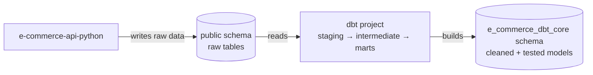
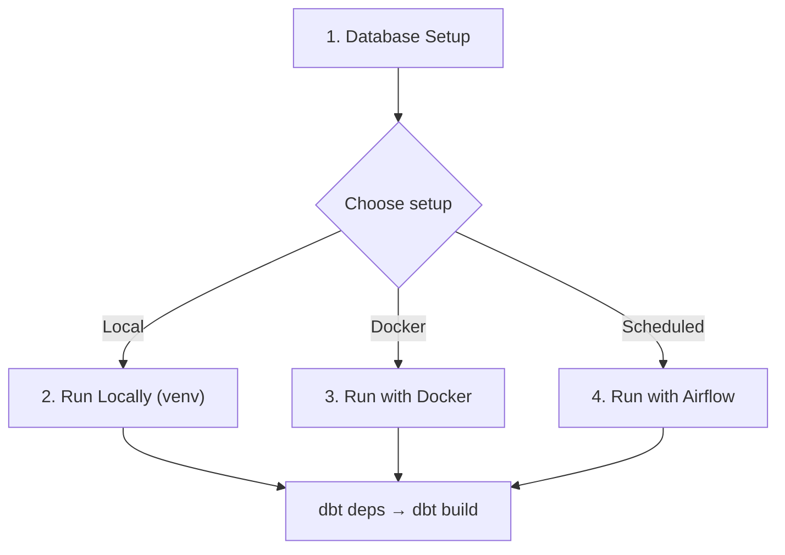

# E-Commerce Data Models (dbt)

dbt project that transforms and tests data for the Music Band T-Shirt E-Commerce platform.

## Purpose

This project adds a transformation layer on top of the e-commerce PostgreSQL database. It reads the raw tables from the `public` schema (written by [e-commerce-api-python](../e-commerce-api-python)) and builds cleaned, tested models into the `e_commerce_dbt_core` schema (configurable via `DBT_SCHEMA_CORE`). Application data is never modified.



Models follow the [official dbt best practices](https://docs.getdbt.com/best-practices/how-we-structure/1-guide-overview) and are organized in three layers:

| Layer | Purpose | Naming | Materialization |
|-------|---------|--------|-----------------|
| `staging` | Clean and rename raw source data | `stg_<entity>.sql` | View |
| `intermediate` | Business logic between staging and marts | `int_<entity>_<verb>.sql` | Ephemeral |
| `marts` | Final facts and dimensions | `fct_<entity>.sql`, `dim_<entity>.sql` | Table |

## Project Structure

```
e-commerce-data-models-dbt/
├── docker-compose.yml                  # dbt CLI service
├── docker-compose.airflow.yml          # Airflow stack (schedules dbt runs)
├── Dockerfile                          # dbt image (dbt-core + dbt-postgres)
├── requirements.txt                    # Python deps: dbt-core + dbt-postgres (local venv & dbt image)
├── .gitignore                          # Excludes target/, logs/, dbt_packages/, .env
├── airflow/                            # Airflow files
│   ├── Dockerfile                      # apache/airflow 2.10.3 + dbt
│   ├── requirements.txt                # Airflow image deps (reuses root requirements.txt for dbt)
│   └── dags/
│       └── dbt_daily_build.py          # Daily 05:00 `dbt build` DAG
└── e-commerce-dbt-core/                # The dbt project
    ├── dbt_project.yml                 # Project configuration (name, paths, materializations)
    ├── profiles.yml                    # Postgres connection settings (env-var driven)
    ├── packages.yml                    # dbt package dependencies (dbt_utils)
    ├── package-lock.yml                # Resolved package versions (generated by `dbt deps`)
    ├── .env                            # Local dev connection/schema variables (git-ignored)
    ├── models/
    │   ├── _groups.yml                 # Model group + owner
    │   ├── staging/
    │   │   └── postgres/               # One subdirectory per source
    │   │       ├── _postgres__sources.yml
    │   │       ├── _postgres__models.yml
    │   │       ├── stg_users.sql
    │   │       └── stg_bands.sql
    │   ├── intermediate/               # int_<entity>_<verb>.sql
    │   └── marts/
    │       └── core/                   # Published models
    │           ├── _core__models.yml
    │           └── dim_users.sql
    ├── macros/                         # Custom Jinja macros
    ├── seeds/                          # CSVs loaded as tables
    ├── snapshots/                      # Slowly-changing-dimension snapshots
    ├── analyses/                       # Ad-hoc SQL
    └── tests/                          # Singular tests
```

`target/`, `logs/`, and `dbt_packages/` are generated by dbt and git-ignored.

## Prerequisites

- Python 3.11+ and pip (local setup only)
- Docker and Docker Compose
- PostgreSQL database from [e-commerce-api-python](../e-commerce-api-python)

Pick **one** of the run setups after the database is ready:



## 1. Database Setup

There is exactly **one** PostgreSQL database in play: the `postgres:17` container **`e-commerce_api_app_db`** (database `e-commerce_db`), started by [e-commerce-api-python](../e-commerce-api-python). It holds both the raw source tables (schema `public`, written by the API) and the dbt output schema (`e_commerce_dbt_core`). The API, the dbt CLI, and the Airflow DAG all point at this same container.

> **⚠️ No local Postgres on 5432.**
> A local Postgres binds `127.0.0.1:5432`, which *shadows* the container's published port — so anything connecting to `localhost:5432` (your DB client, a locally-running API) silently lands on the **wrong** database, while Airflow/dbt (which connect via the Docker name `e-commerce_api_app_db`) use the container.
>
> If you have Homebrew Postgres installed, stop it for this project: `brew services stop postgresql@14`. Verify only Docker listens on 5432: `lsof -nP -iTCP:5432 -sTCP:LISTEN`.

Start the container and create the source tables:

```bash
# Start PostgreSQL (from the API project)
cd ../e-commerce-api-python
docker compose up -d postgres

# Create source tables (if not already created by the API)
docker exec e-commerce_api_app_db psql -U admin -d e-commerce_db -c "
CREATE TABLE IF NOT EXISTS users (
    id UUID PRIMARY KEY,
    email VARCHAR(255) NOT NULL UNIQUE,
    first_name VARCHAR(50) NOT NULL,
    last_name VARCHAR(50) NOT NULL,
    password VARCHAR(60) NOT NULL,
    role VARCHAR(8) NOT NULL,
    is_active BOOLEAN,
    created_at TIMESTAMPTZ NOT NULL DEFAULT now(),
    updated_at TIMESTAMPTZ NOT NULL DEFAULT now()
);
CREATE TABLE IF NOT EXISTS bands (
    id UUID PRIMARY KEY,
    name VARCHAR(150) NOT NULL UNIQUE,
    country VARCHAR(100),
    genre VARCHAR(100),
    created_at TIMESTAMPTZ NOT NULL DEFAULT now(),
    updated_at TIMESTAMPTZ NOT NULL DEFAULT now()
);"
```

## 2. Run Locally (venv)

```bash
cd ../e-commerce-data-models-dbt

# Create and activate a virtual environment
python3 -m venv venv
source venv/bin/activate        # Windows: venv\Scripts\activate

# Install dependencies
pip install -r requirements.txt

# Enter the dbt project and load connection/schema variables
cd e-commerce-dbt-core
set -a; source .env; set +a    # exports POSTGRES_* and DBT_SCHEMA_CORE

# Use the project's profiles.yml instead of ~/.dbt
export DBT_PROFILES_DIR="$PWD"

# Install packages, then run models + data tests
dbt deps
dbt build

deactivate                      # when done
```

> **Note:** `profiles.yml` reads its connection settings from environment variables (`POSTGRES_HOST`, `POSTGRES_USER`, `POSTGRES_PASSWORD`, `POSTGRES_DB`, `DBT_SCHEMA_CORE`) — no hardcoded defaults. If you don't set `DBT_PROFILES_DIR`, pass `--profiles-dir .` to every command instead.

## 3. Run with Docker

```bash
cd ../e-commerce-data-models-dbt

# Build the image
docker compose build

# Install packages, then run models + data tests
docker compose run --rm dbt deps
docker compose run --rm dbt build
```

Notes:

- The service's `working_dir` is the dbt project (`/usr/app/e-commerce-dbt-core`), so dbt finds `dbt_project.yml` and `profiles.yml` automatically (`DBT_PROFILES_DIR` is set for you).
- Connection and schema variables are provided as defaults in `docker-compose.yml` — e.g. `POSTGRES_HOST=e-commerce_api_app_db` and `DBT_SCHEMA_CORE=e_commerce_dbt_core`. To override them, add a root `.env` file; Docker Compose auto-loads it for `${VAR:-default}` interpolation.
- The dbt container connects to PostgreSQL through the external Docker network `e-commerce-api-python_template_network` (created when the API stack starts).

## 4. Run with Airflow (scheduled)

Airflow runs the same dbt project daily at 05:00 (`America/Costa_Rica`) via the **`dbt_daily_build`** DAG, which chains `dbt deps` → `dbt build`. It uses a single-node **LocalExecutor** (the scheduler runs the tasks) and its **own** Postgres for Airflow metadata — the e-commerce data DB is only touched by the dbt tasks.

### Step by step (run Airflow locally)

**1. Prerequisites** — the API Postgres must be running and the external Docker network must exist (both come up with the API stack):

```bash
cd ../e-commerce-data-models-dbt
docker network ls    # expect: e-commerce-api-python_template_network
docker ps            # expect: e-commerce_api_app_db (postgres:17)
```

**2. Export the encryption key** for Airflow metadata — required, the compose file fails fast without it:

```bash
export FERNET_KEY=$(python3 -c "from cryptography.fernet import Fernet; print(Fernet.generate_key().decode())")
```

> The key is per-shell. Re-export it each session, or put `FERNET_KEY=...` in a root `.env` (Compose auto-loads it).

**3. Build the images** (first time, or after `airflow/requirements.txt` / `airflow/Dockerfile` changes):

```bash
docker compose -f docker-compose.airflow.yml build
```

**4. One-shot init** — migrates the Airflow metadata DB and creates the admin user (idempotent):

```bash
docker compose -f docker-compose.airflow.yml up airflow-init
```

**5. Start the scheduler and webserver:**

```bash
docker compose -f docker-compose.airflow.yml up -d
docker compose -f docker-compose.airflow.yml ps   # all services Running
```

**6. Open the UI** at <http://localhost:8085> and log in with `admin` / `admin` (overridable via `AIRFLOW_ADMIN_PASSWORD`). The **dbt_daily_build** DAG is listed once the scheduler picks it up.

**7. Trigger a run:** open **dbt_daily_build** → ▶ **Trigger DAG**, and watch the grid — `dbt_deps` and `dbt_build` should turn green. For live output:

```bash
docker compose -f docker-compose.airflow.yml logs -f airflow-scheduler
```

**8. Confirm the data landed** in the e-commerce DB:

```bash
# Schemas — should include e_commerce_dbt_core
docker exec e-commerce_api_app_db psql -U admin -d e-commerce_db -c '\dn'

# Tables — staging views + marts tables
docker exec e-commerce_api_app_db psql -U admin -d e-commerce_db -c '\dt e_commerce_dbt_core.*'

# Row counts — proves staging -> marts really transformed data
docker exec e-commerce_api_app_db psql -U admin -d e-commerce_db \
  -c 'SELECT COUNT(*) FROM e_commerce_dbt_core.<your_mart_table>;'
```

**9. Stop / reset:**

```bash
docker compose -f docker-compose.airflow.yml down      # stop the stack (data DB untouched)
docker compose -f docker-compose.airflow.yml down -v   # full reset (drops the Airflow metadata volume)
```

### Troubleshooting

| Symptom | Cause / fix |
|---|---|
| `FERNET_KEY is missing a value` | Key not exported in this shell → repeat step 2 |
| DAG missing in the UI | Scheduler not running, or `airflow/dags` not mounted → restart the stack (step 5) |
| `dbt_build` fails with "could not translate host name" | API Postgres is stopped → start the API stack (step 1) |
| DAG succeeds but **no changes in the database** | You're connected to a different Postgres than the container — usually a local Homebrew Postgres shadowing `localhost:5432`. Stop it and make sure your client/API hit `e-commerce_api_app_db` (see [section 1](#1-database-setup)) |
| A task fails but the logic looks right | Click the red task box → **Log**; it shows the real dbt error |

Notes:

- **Port 8085** is used because the API app already publishes **8080**.
- The dbt project is mounted read-write into the containers; `target/` and `dbt_packages/` persist there (git-ignored).
- On macOS you can ignore the `AIRFLOW_UID` warning; on Linux set `AIRFLOW_UID=$(id -u)`.

## Useful Commands

Run the local commands from inside `e-commerce-dbt-core` (after `export DBT_PROFILES_DIR="$PWD"` from section 2):

| Local | Docker | Description |
|-------|--------|-------------|
| `dbt debug` | `docker compose run --rm dbt debug` | Test database connection |
| `dbt deps` | `docker compose run --rm dbt deps` | Install package dependencies |
| `dbt run` | `docker compose run --rm dbt run` | Run all models |
| `dbt run -s <model>` | `docker compose run --rm dbt run -s <model>` | Run a specific model |
| `dbt test` | `docker compose run --rm dbt test` | Run all data tests |
| `dbt docs generate` | `docker compose run --rm dbt docs generate` | Generate documentation |
| `dbt source freshness` | `docker compose run --rm dbt source freshness` | Check source data freshness |

## License

Part of the [EndToEndLabCR](https://github.com/deriancampos/EndToEndLabCR) project.
