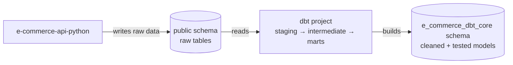
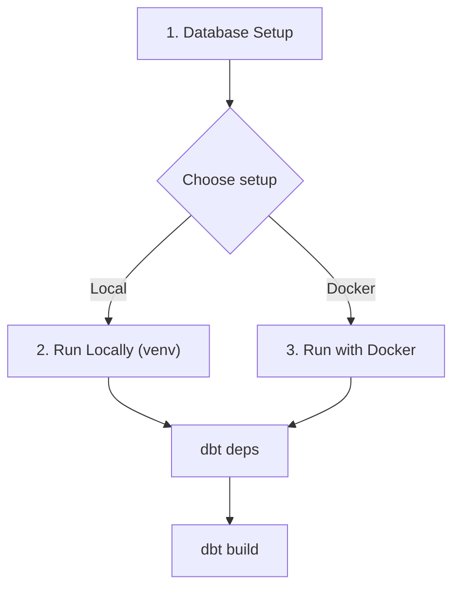

# E-Commerce Data Models (dbt)

dbt project that transforms and tests data for the Music Band T-Shirt E-Commerce platform.

## Purpose

This project adds a transformation layer on top of the e-commerce PostgreSQL database. It reads raw tables from the `public` schema (managed by [e-commerce-api-python](../e-commerce-api-python)) and builds cleaned, tested models into the `e_commerce_dbt_core` output schema (configurable via the `DBT_SCHEMA_CORE` environment variable) — application data is never modified.



Models are organized in three layers, following the [official dbt best practices](https://docs.getdbt.com/best-practices/how-we-structure/1-guide-overview):

| Layer | Purpose | Naming | Materialization |
|-------|---------|--------|-----------------|
| `staging` | Clean and rename raw source data | `stg_<entity>.sql` | View |
| `intermediate` | Business logic between staging and marts | `int_<entity>_<verb>.sql` | Ephemeral |
| `marts` | Final facts and dimensions | `fct_<entity>.sql`, `dim_<entity>.sql` | Table |

## Project Structure

```
e-commerce-data-models-dbt/
├── docker-compose.yml                  # Container orchestration (dbt CLI service)
├── Dockerfile                          # dbt image (dbt-core + dbt-postgres)
├── requirements.txt                    # Python dependencies (local venv)
├── .gitignore                          # Excludes target/, dbt_packages/, logs/, .env
└── e-commerce-dbt-core/                # The dbt project
    ├── dbt_project.yml                 # Project configuration (name, paths, materializations)
    ├── profiles.yml                    # Postgres connection settings (env-var driven)
    ├── packages.yml                    # dbt package dependencies (dbt_utils)
    ├── .env                            # Local dev connection/schema variables (git-ignored)
    ├── models/
    │   ├── _groups.yml                 # Model group + owner
    │   ├── staging/
    │   │   └── postgres/               # One subdirectory per source
    │   │       ├── _postgres__sources.yml
    │   │       ├── _postgres__models.yml
    │   │       ├── stg_users.sql
    │   │       └── stg_bands.sql
    │   ├── intermediate/               # int_<entity>_<verb>.sql (empty until needed)
    │   └── marts/
    │       └── core/                   # Published models (dim_users)
    │           ├── _core__models.yml
    │           └── dim_users.sql
    ├── macros/                         # Custom Jinja macros (empty)
    ├── seeds/                          # CSVs loaded as tables (empty)
    ├── snapshots/                      # Slowly-changing-dimension snapshots (empty)
    ├── analyses/                       # Ad-hoc SQL (empty)
    └── tests/                          # Singular tests (empty)
```

`dbt_packages/`, `target/`, and `logs/` are generated by dbt and git-ignored.

## Prerequisites

- Python 3.11+ and pip (local setup only)
- Docker and Docker Compose
- PostgreSQL database from [e-commerce-api-python](../e-commerce-api-python)

The overall workflow — pick **one** of the two setups after the database is ready:



## 1. Database Setup

Both setups need the PostgreSQL container running with the source tables created:

```bash
# Start PostgreSQL (from the API project)
cd ../e-commerce-api-python
docker compose up -d postgres

# Create source tables (if not already created by the API)
docker exec e-commerce_api_app_db psql -U admin -d e-commerce_db -c "
CREATE TABLE IF NOT EXISTS users (
    id UUID PRIMARY KEY,
    email VARCHAR(255) NOT NULL UNIQUE,
    first_name VARCHAR(50) NOT NULL,
    last_name VARCHAR(50) NOT NULL,
    password VARCHAR(60) NOT NULL,
    role VARCHAR(8) NOT NULL,
    is_active BOOLEAN,
    created_at TIMESTAMPTZ NOT NULL DEFAULT now(),
    updated_at TIMESTAMPTZ NOT NULL DEFAULT now()
);
CREATE TABLE IF NOT EXISTS bands (
    id UUID PRIMARY KEY,
    name VARCHAR(150) NOT NULL UNIQUE,
    country VARCHAR(100),
    genre VARCHAR(100),
    created_at TIMESTAMPTZ NOT NULL DEFAULT now(),
    updated_at TIMESTAMPTZ NOT NULL DEFAULT now()
);"
```

## 2. Run Locally (venv)

```bash
cd ../e-commerce-data-models-dbt

# Create and activate a virtual environment
python3 -m venv venv
source venv/bin/activate        # Windows: venv\Scripts\activate

# Install dependencies
pip install -r requirements.txt

# Enter the dbt project and load connection/schema variables
cd e-commerce-dbt-core
set -a; source .env; set +a    # exports POSTGRES_* and DBT_SCHEMA_CORE

# Use the project's profiles.yml instead of ~/.dbt (which is empty)
export DBT_PROFILES_DIR="$PWD"

# Install packages and build (run models + data tests)
dbt deps
dbt build

deactivate                      # when done
```

> **Note:** `profiles.yml` reads its connection settings from environment variables (`POSTGRES_HOST`, `POSTGRES_USER`, `POSTGRES_PASSWORD`, `POSTGRES_DB`, `DBT_SCHEMA_CORE`) — no hardcoded defaults. If you don't set `DBT_PROFILES_DIR`, pass `--profiles-dir .` to every command instead.

## 3. Run with Docker

```bash
cd ../e-commerce-data-models-dbt

# Build the image
docker compose build

# Install packages and build (run models + data tests)
docker compose run --rm dbt deps
docker compose run --rm dbt build
```

Notes:

- The service's `working_dir` is the dbt project (`/usr/app/e-commerce-dbt-core`), so dbt finds `dbt_project.yml` and `profiles.yml` automatically (`DBT_PROFILES_DIR` is set for you).
- Connection and schema variables are provided as defaults in `docker-compose.yml` — e.g. `POSTGRES_HOST=e-commerce_api_app_db` on the shared Docker network and `DBT_SCHEMA_CORE=e_commerce_dbt_core`. To override them, recreate a root `.env` file with your values; Docker Compose auto-loads it for `${VAR:-default}` interpolation.
- The dbt container connects to PostgreSQL through the shared Docker network `e-commerce-api-python_template_network` (created automatically when the database starts).

## Useful Commands

Run the local commands from inside `e-commerce-dbt-core` (after `export DBT_PROFILES_DIR="$PWD"` from section 2):

| Local | Docker | Description |
|-------|--------|-------------|
| `dbt debug` | `docker compose run --rm dbt debug` | Test database connection |
| `dbt deps` | `docker compose run --rm dbt deps` | Install package dependencies |
| `dbt run` | `docker compose run --rm dbt run` | Run all models |
| `dbt run -s <model>` | `docker compose run --rm dbt run -s <model>` | Run a specific model |
| `dbt test` | `docker compose run --rm dbt test` | Run all data tests |
| `dbt docs generate` | `docker compose run --rm dbt docs generate` | Generate documentation |
| `dbt source freshness` | `docker compose run --rm dbt source freshness` | Check source data freshness |

## License

Part of the [EndToEndLabCR](https://github.com/deriancampos/EndToEndLabCR) project.