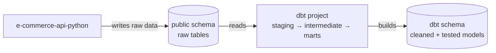
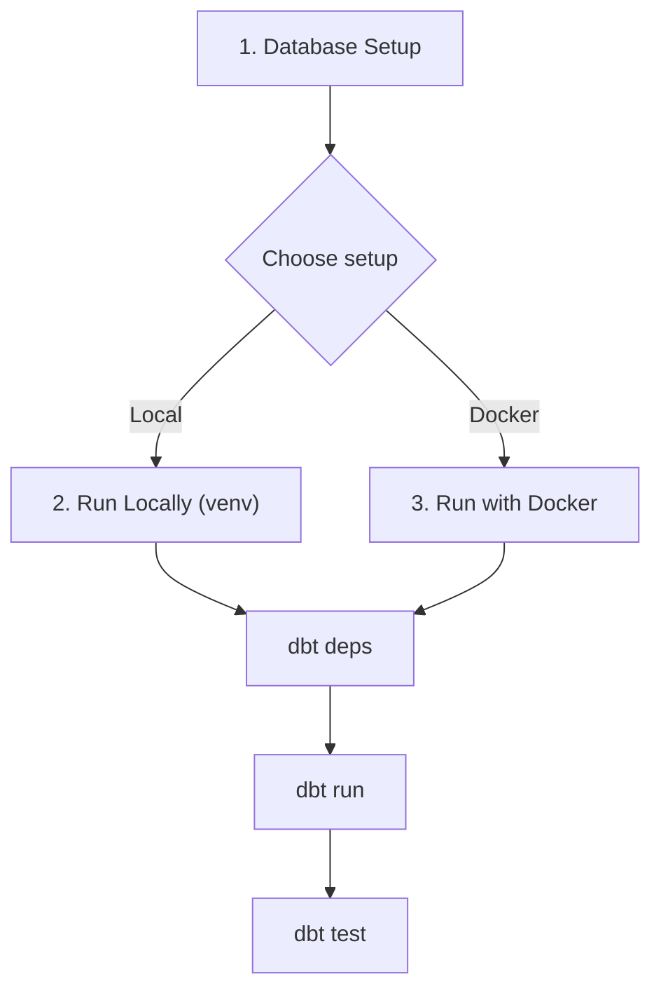

# E-Commerce Data Models (dbt)

dbt project that transforms and tests data for the Music Band T-Shirt E-Commerce platform.

## Purpose

This project adds a transformation layer on top of the e-commerce PostgreSQL database. It reads raw tables from the `public` schema (managed by [e-commerce-api-python](../e-commerce-api-python)) and builds cleaned, tested models in the `dbt` schema — application data is never modified.



Models are organized in three layers, following the [official dbt best practices](https://docs.getdbt.com/best-practices/how-we-structure/1-guide-overview):

| Layer | Purpose | Naming | Materialization |
|-------|---------|--------|-----------------|
| `staging` | Clean and rename raw source data | `stg_<entity>.sql` | View |
| `intermediate` | Business logic between staging and marts | `int_<entity>_<verb>.sql` | Ephemeral |
| `marts` | Final facts and dimensions | `fct_<entity>.sql`, `dim_<entity>.sql` | Table |

## Project Structure

```
e-commerce-data-models-dbt/
├── dbt_project.yml                  # Project configuration
├── profiles.yml                     # Database connection settings
├── packages.yml                     # dbt package dependencies
├── requirements.txt                 # Python dependencies
├── Dockerfile                       # Docker image definition
├── docker-compose.yml               # Container orchestration
└── models/
    ├── staging/
    │   └── postgres/                # One subdirectory per source
    │       ├── _postgres__sources.yml
    │       ├── _postgres__models.yml
    │       ├── stg_users.sql
    │       └── stg_bands.sql
    ├── intermediate/                # int_<entity>_<verb>.sql
    └── marts/                       # dim_/fct_ models
```

## Prerequisites

- Python 3.11+ and pip (local setup only)
- Docker and Docker Compose
- PostgreSQL database from [e-commerce-api-python](../e-commerce-api-python)

The overall workflow — pick **one** of the two setups after the database is ready:



## 1. Database Setup

Both setups need the PostgreSQL container running with the source tables created:

```bash
# Start PostgreSQL (from the API project)
cd ../e-commerce-api-python
docker compose up -d postgres

# Create source tables (if not already created by the API)
docker exec e-commerce_api_app_db psql -U admin -d e-commerce_db -c "
CREATE TABLE IF NOT EXISTS users (
    id UUID PRIMARY KEY,
    email VARCHAR(255) NOT NULL UNIQUE,
    first_name VARCHAR(50) NOT NULL,
    last_name VARCHAR(50) NOT NULL,
    password VARCHAR(60) NOT NULL,
    role VARCHAR(8) NOT NULL,
    is_active BOOLEAN,
    created_at TIMESTAMPTZ NOT NULL DEFAULT now(),
    updated_at TIMESTAMPTZ NOT NULL DEFAULT now()
);
CREATE TABLE IF NOT EXISTS bands (
    id UUID PRIMARY KEY,
    name VARCHAR(150) NOT NULL UNIQUE,
    country VARCHAR(100),
    genre VARCHAR(100),
    created_at TIMESTAMPTZ NOT NULL DEFAULT now(),
    updated_at TIMESTAMPTZ NOT NULL DEFAULT now()
);"
```

## 2. Run Locally (venv)

```bash
cd ../e-commerce-data-models-dbt

# Create and activate a virtual environment
python3 -m venv venv
source venv/bin/activate        # Windows: venv\Scripts\activate

# Install dependencies
pip install -r requirements.txt

# Point dbt to localhost (Docker host differs)
export POSTGRES_HOST=localhost

# Build and test
dbt deps
dbt run
dbt test

deactivate                      # when done
```

## 3. Run with Docker

```bash
cd ../e-commerce-data-models-dbt

# Build the image
docker compose build

# Build and test
docker compose run --rm dbt deps
docker compose run --rm dbt run
docker compose run --rm dbt test
```

The dbt container connects to PostgreSQL through the shared Docker network `e-commerce-api-python_template_network` (created automatically when the database starts).

## Useful Commands

| Local | Docker | Description |
|-------|--------|-------------|
| `dbt debug` | `docker compose run --rm dbt debug` | Test database connection |
| `dbt run` | `docker compose run --rm dbt run` | Run all models |
| `dbt run -s <model>` | `docker compose run --rm dbt run -s <model>` | Run a specific model |
| `dbt test` | `docker compose run --rm dbt test` | Run all data tests |
| `dbt docs generate` | `docker compose run --rm dbt docs generate` | Generate documentation |

## License

Part of the [EndToEndLabCR](https://github.com/deriancampos/EndToEndLabCR) project.
